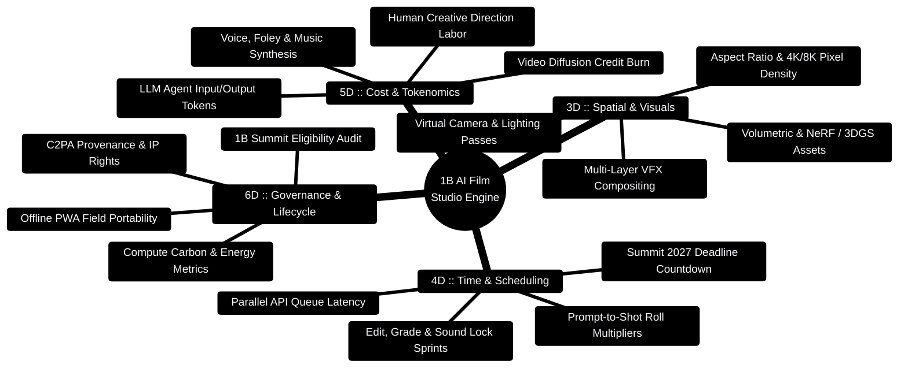
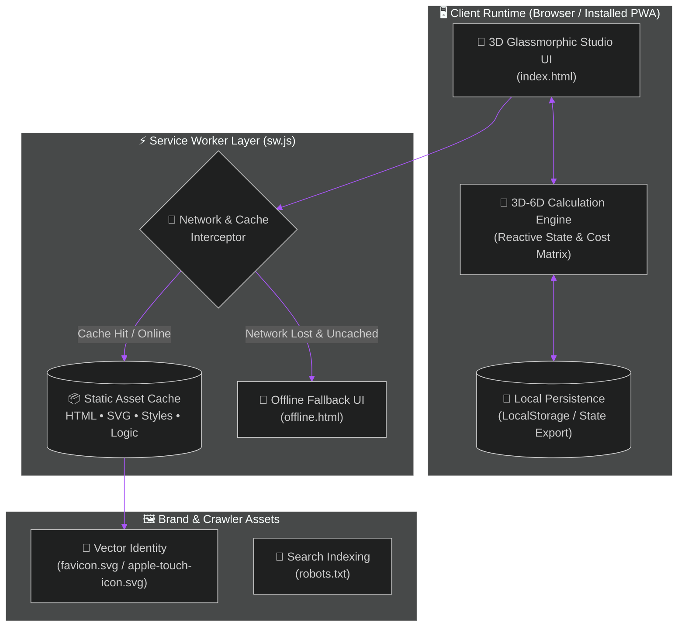

### Key Architectural & Visual Upgrades Included

* **Repository Asset Alignment**: Maps the exact Progressive Web App (PWA) file tree from your archive, including `index.html`, the `sw.js` Service Worker, `offline.html` fallback, SVG app icons (`favicon.svg`, `apple-touch-icon.svg`), and `robots.txt` crawler configuration (`User-agent: * Allow: /`).


* **Dynamic 3D & Animated Visuals**: Uses `capsule-render` 3D waving gradients, `readme-typing-svg` live terminal headers, `skillicons.dev` iconography, and custom hex-swatch badges inspired by modern README generators.
* **3D to 6D Studio Engineering Architecture**: Structures the calculator around spatial/visual rendering (**3D**), timeline & frame-rate scheduling (**4D**), multi-agent API tokenomics & production budgeting (**5D**), and compliance, licensing & festival governance (**6D**) for the **1 Billion Followers Summit 2027 — AI Film Award**.

```markdown
<div align="center">

<!-- 3D DYNAMIC ANIMATED HEADER BANNER -->


<!-- ANIMATED TYPING SUBHEADER -->
<a href="https://git.io/typing-svg">
  
</a>

<br/>

<!-- SHIELD BADGES -->
[](#)
[](#-multi-dimensional-studio-framework-3d--4d--5d--6d)
[](#-pwa--offline-first-architecture)
[](#-tech-stack--design-system)
[](#-license)

<br/>

<!-- QUICK NAVIGATION PILLS -->
[✨ Overview](#-overview) •
[🧊 3D–6D Engine](#-multi-dimensional-studio-framework-3d--4d--5d--6d) •
[🏗️ System Architecture](#️-system-architecture) •
[🎨 UI & Color System](#-ui-design--color-system) •
[📂 Project Structure](#-repository-structure) •
[🚀 Quick Start](#-quick-start--deployment)

</div>

---

## ✨ Overview

**1B-AI-Film-Studio-Calculator** is a zero-dependency, offline-capable **Progressive Web App (PWA)** engineered for AI filmmakers, post-production editors, autonomous AI agent developers, and creative agencies preparing competitive submissions for the **1 Billion Followers Summit 2027 — AI Film Award**.

Modern AI filmmaking requires orchestrating dozens of generative models—spanning text-to-video, 3D Gaussian splatting, lip-sync, spatial audio, upscaling, and autonomous multi-agent pipelines. This calculator transforms complex creative workflows into predictable budgets, compute schedules, and festival-compliant production roadmaps.

### 🎯 Who Is This For?
| Target Persona | Primary Use Case | Core Calculator Output |
| :--- | :--- | :--- |
| **🎬 AI Video Creators** | Estimating prompt-to-usable-shot ratios (roll ratios) across Sora, Runway, Kling, Luma, and Veo. | Generation credits, render cost per finished minute, and storage footprint. |
| **✂️ Film & VFX Editors** | Planning NLE assembly, 4K/8K upscaling, frame interpolation, and color grading timelines. | Post-production labor hours, GPU render times, and delivery milestones. |
| **🤖 AI Agent Developers** | Designing autonomous director/script/storyboard sub-agents and API orchestration workflows. | LLM token burn rate, API webhook concurrency, and orchestration overhead. |
| **🏢 Agencies & Studios** | Pitching client productions and structuring ROI models for the Summit's AI Film Award prize pool. | Full-spectrum P&L, contingency buffers, team resource allocation, and margin analysis. |

---

## 🧊 Multi-Dimensional Studio Framework (3D / 4D / 5D / 6D)

Inspired by advanced engineering and virtual production modeling, the calculator evaluates every AI film project across **four integrated operational dimensions**:



* **🧊 3D — Spatial & Visual Compute Modeling**: Calculates resolution scaling (1080p → 4K → 8K), volumetric/3D environment generation, depth-map passes, and multi-plane compositing complexity.
* **⏱️ 4D — Temporal & Pipeline Scheduling**: Factors in realistic generative "hit rates" (e.g., 10:1 or 20:1 generation-to-cut ratios), API rate limits, render queue bottlenecks, and backward scheduling from the **1 Billion Followers Summit 2027** submission window.
* **💎 5D — Financial Tokenomics & Multi-Model Budgeting**: Aggregates real-time unit economics across video diffusion APIs, LLM agent tokens, audio synthesis, cloud GPU rentals, and human post-production day rates.
* **🛡️ 6D — Governance, Rights & Sustainability**: Tracks commercial licensing tiers, synthetic media disclosure requirements, C2PA metadata readiness, and total compute energy footprint.

---

## 🏗️ System Architecture

The application is built on a resilient, **Offline-First PWA Architecture** powered by vanilla web standards—ensuring instant load times on set, in edit bays, or while traveling without connectivity.



### 🔄 Service Worker (`sw.js`) Lifecycle

1. **Install Phase**: Pre-caches core shell assets (`index.html`, `offline.html`, `favicon.svg`, `apple-touch-icon.svg`) for immediate local availability.
2. **Activate Phase**: Prunes outdated cache versions to guarantee accurate model pricing and calculation formulas.
3. **Fetch Phase**: Serves cached studio modules instantaneously while gracefully degrading to `offline.html` if uncached external resources are requested without network access.

---

## 🎨 UI Design & Color System

The interface is crafted around a **Cyber-Cinema Dark Mode** aesthetic, minimizing eye strain in dimly lit color-grading suites while highlighting critical financial and timeline telemetry.

### 🌈 Studio Color Palette

| Role | Token Name | Hex Code | Preview | Usage in Calculator |
| --- | --- | --- | --- | --- |
| **Canvas Base** | `Obsidian Studio` | `#0A0E17` |  | Primary background & deep viewport canvas |
| **3D Surface** | `Glass Slate` | `#111827` |  | Frosted glass cards, modals & calculator panels |
| **Primary Accent** | `Quantum Indigo` | `#6366F1` |  | Primary interactive sliders, active tabs & CTAs |
| **AI Highlight** | `Holo Cyan` | `#00E5FF` |  | Real-time token telemetry & agent pipeline metrics |
| **Summit Gold/Pink** | `Award Magenta` | `#EC4899` |  | 1B Summit KPI targets, prize ROI & budget alerts |
| **Status Optimal** | `Render Emerald` | `#10B981` |  | Under-budget indicators & PWA offline readiness |

### 🖥️ 3D Spatial Viewport Layout

```text
+-----------------------------------------------------------------------------------+
|  [🎬 1B AI FILM STUDIO CALCULATOR]           [⚡ PWA: READY] [🏆 SUMMIT 2027 MODE] |
+---------------------------------------+-------------------------------------------+
|  🎛️ INPUT PARAMETERS (3D / 4D)        |  📊 REAL-TIME TELEMETRY (5D / 6D)         |
|  -----------------------------------  |  ---------------------------------------  |
|  • Target Film Duration : [ 08:00 ]   |  💰 Estimated Total Budget : $14,850.00   |
|  • Resolution & Spatial : [ 4K 3D ]   |  🪙 Generative API Credits : 185,400      |
|  • Prompt Roll Ratio    : [ 12 : 1 ]  |  🤖 AI Agent Token Burn    : 42.5M Tok    |
|  • Video Diffusion Tier : [ Ultra ]   |  ⏳ Est. Render & Edit Time: 164 Hours    |
|  • Agent Orchestration  : [ Active ]  |  🛡️ 1B Summit Compliance   : 100% PASS    |
|                                       |                                           |
|  [+ Add Scene] [⚙️ Model Mix]         |  [📥 Export Production Sheet] [🔄 Reset]  |
+---------------------------------------+-------------------------------------------+

```

---

## 🛠️ Tech Stack & Design System

* **Core Markup & Structure**: Semantic HTML5 (`index.html`, `offline.html`) with accessible ARIA attributes and mobile viewport optimization.
* **Styling & Visual Effects**: Modern CSS3 featuring hardware-accelerated 3D transforms, CSS Grid/Flexbox layouts, custom properties, and responsive media queries.
* **Computation Engine**: Vanilla ES6+ JavaScript for zero-latency reactive calculations without heavyweight framework overhead.
* **Offline Capabilities**: Native Service Worker API (`sw.js`) for deterministic caching and offline execution.
* **Vector Graphics**: Custom scalable SVG iconography (`favicon.svg`, `apple-touch-icon.svg`) for crisp rendering on Retina and 4K/8K studio displays.

---

## 📂 Repository Structure

```text
1B-AI-Film-Studio-Calculator-main/
├── 📄 index.html             # Main application UI, 3D-6D calculator engine & PWA registration
├── 📄 offline.html           # Dedicated offline fallback screen for disconnected environments
├── ⚙️ sw.js                  # Service Worker script handling asset caching & offline routing
├── 🎨 favicon.svg            # Scalable vector browser icon
├── 📱 apple-touch-icon.svg   # High-resolution iOS/iPadOS home screen web-app icon
├── 🤖 robots.txt             # Search engine crawler directives (User-agent: * Allow: /)
└── 📖 README.md              # Project documentation, architecture & studio guide

```

---

## 🧮 Core Calculation Modules

Calculates the true cost of generative video by accounting for **Prompt Roll Ratios** (the number of generations required to achieve one hero shot):

$$\text{Total Video Cost} = \sum_{i=1}^{N} \left( \text{Shot Duration}_i \times \text{Roll Ratio}_i \times \text{Cost Per Second}_{m} \right)$$

* Supports multi-model blending (e.g., high-motion shots in Runway/Kling, cinematic wide shots in Sora/Veo, 3D camera moves in Luma).

Built for AI agent developers using automated pipelines (n8n, Claude Code sub-agents, LangGraph, or custom Python orchestrators) to generate scripts, continuity Bibles, JSON prompt matrices, and shot lists:

$$\text{Agent Pipeline Cost} = \text{Scenes} \times \text{Iterations} \times \left( \text{Tokens}_{\text{in}} \cdot P_{\text{in}} + \text{Tokens}_{\text{out}} \cdot P_{\text{out}} \right)$$

Estimates secondary compute and human finishing costs:

* **Visual Finishing**: Topaz/AI 4K–8K upscaling, deflickering, rotoscoping, and NLE assembly.
* **Sonic Architecture**: AI voice cloning/dialogue replacement, generative score composition, and spatial stems.

---

## 🚀 Quick Start & Deployment

Because **1B-AI-Film-Studio-Calculator** is built with zero external build dependencies, you can run it locally in seconds or deploy it to any static edge network.

### 💻 Local Development

```bash
# 1. Clone the repository
git clone [https://github.com/your-username/1B-AI-Film-Studio-Calculator.git](https://github.com/your-username/1B-AI-Film-Studio-Calculator.git)

# 2. Navigate into the project directory
cd 1B-AI-Film-Studio-Calculator

# 3. Launch a local server (required for Service Worker / sw.js registration)
npx serve .
# OR using Python 3:
python3 -m http.server 8080

```

Open `http://localhost:8080` in your browser. To test offline mode, open **Chrome DevTools → Application → Service Workers** and toggle **Offline**.

### ☁️ One-Click Cloud Deployment

* **GitHub Pages**: Push to `main` and enable GitHub Pages from the root directory (`/`).
* **Vercel / Netlify / Cloudflare Pages**: Import the repository with **Build Command** left blank and **Output Directory** set to `.`.

---

## 🗺️ Roadmap to Summit 2027

* [x] **Phase 1**: Core single-page calculator architecture (`index.html`) & responsive studio UI.
* [x] **Phase 2**: Offline-first PWA Service Worker (`sw.js`), `offline.html` fallback, and custom SVG icons.
* [ ] **Phase 3**: Interactive 5D Cost Breakdown charts and exportable PDF/CSV call sheets & budget reports.
* [ ] **Phase 4**: Live webhook integration for automated n8n / AI agent cost tracking.
* [ ] **Phase 5**: Preset templates tailored to official **1 Billion Followers Summit 2027 — AI Film Award** submission categories.

---

## 🤝 Contributing

Contributions from AI filmmakers, VFX supervisors, and agent developers are welcome!

1. **Fork** the repository.
2. **Create** your feature branch (`git checkout -b feature/6d-telemetry-module`).
3. **Commit** your changes (`git commit -m 'Add 6D C2PA compliance checklist'`).
4. **Push** to the branch (`git push origin feature/6d-telemetry-module`).
5. **Open** a Pull Request.

---

## 📜 License

Distributed under the **MIT License**. Free to use, modify, and distribute for personal, agency, and studio productions.

**Engineered for the Future of Cinema • 1 Billion Followers Summit 2027**

Would you like me to customize the GitHub username/repository URLs inside the badges or add specific default pricing presets for the video models in your `index.html`?
